# Central de Pedidos

<p align="center">
  
  
  
  
</p>
<p align="center">
  
  
  
  
</p>
<p align="center">
  
  
  
  
  
  
</p>

<p align="center">
  Aplicativo desktop que reúne, num lugar só, os <b>pedidos de clientes</b> e os <b>planos de corte</b>
  de toda a equipe de vendas — com uma <b>agenda visual dos prazos de entrega</b>, saldo a entregar
  calculado sozinho e cores que mostram na hora o que está atrasado, o que vence hoje e o que já foi entregue.
</p>

<p align="center">
  <a href="#-visão-geral">Visão Geral</a> •
  <a href="#-em-números">Números</a> •
  <a href="#-telas">Telas</a> •
  <a href="#-funcionalidades">Funcionalidades</a> •
  <a href="#️-arquitetura">Arquitetura</a> •
  <a href="#️-como-foi-desenvolvido">Desenvolvimento</a> •
  <a href="#-estrutura-do-repositório">Estrutura</a>
</p>

---

## 📌 Visão Geral

Numa empresa de corte e venda de aço (bobinas, rolos e chapas), cada vendedor registrava os
**pedidos** (material já cortado, em estoque) e os **planos de corte** (serviço de cortar uma
bobina para o cliente) em **planilhas separadas**. Ninguém via o que o outro estava fazendo, e o
acompanhamento dos prazos dependia de cada um lembrar de olhar a sua.

| ❌ Problema | 💡 Solução | ✅ Resultado |
|---|---|---|
| Uma planilha por vendedor, sem ligação entre elas | Um programa único numa pasta da rede, usado por todos ao mesmo tempo | Todos veem tudo, com filtro por vendedor |
| Prazos espalhados em linhas de tabela | **Agenda** em forma de calendário, com cores por situação do prazo | Atrasados e entregas do dia saltam aos olhos |
| "Falta entregar" calculado à mão | Entregas lançadas em kg; o saldo é calculado sozinho | Item entregue ganha um ✔ verde e o pedido vira **Atendido** |
| Digitação repetida e nomes escritos de jeitos diferentes | Botão HOJE, cliente com sugestões, "copiar item de cima", pedido com vários itens | Menos digitação e dados padronizados |
| Não se sabia quem registrou cada linha | Nome tirado do usuário do Windows, sem digitar | Cada registro mostra o vendedor |
| Duas pessoas mexendo na mesma linha da planilha | **Trava por pedido/plano**: o colega vê quem está editando | Nada se perde por gravação em cima |
| Linha apagada sem querer sumia para sempre | **Lixeira** com restaurar e excluir de vez | Exclusão segura |

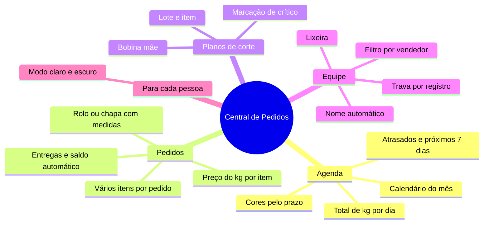

**Objetivos:** dar a toda a equipe a mesma visão dos compromissos, reduzir atrasos esquecidos e
tirar trabalho repetitivo de quem vende.

## 📊 Em números

| Indicador | Valor |
|---|---|
| ✅ Testes automáticos | **82** (regras, banco e janela) |
| 🧾 Linhas de código | **~2.900** no programa + **~750** de testes |
| 🔀 Pull requests | **8** |
| 🧭 Fases entregues | **6** (0.1 a 0.6) |
| 🏷️ Versão atual | **0.6.1** |
| 🖼️ Ícones | Material Symbols, todos escolhidos por foto |

## 📸 Telas

> Todas as telas usam **dados fictícios** (clientes, vendedores, números e lotes inventados).

<p align="center">
  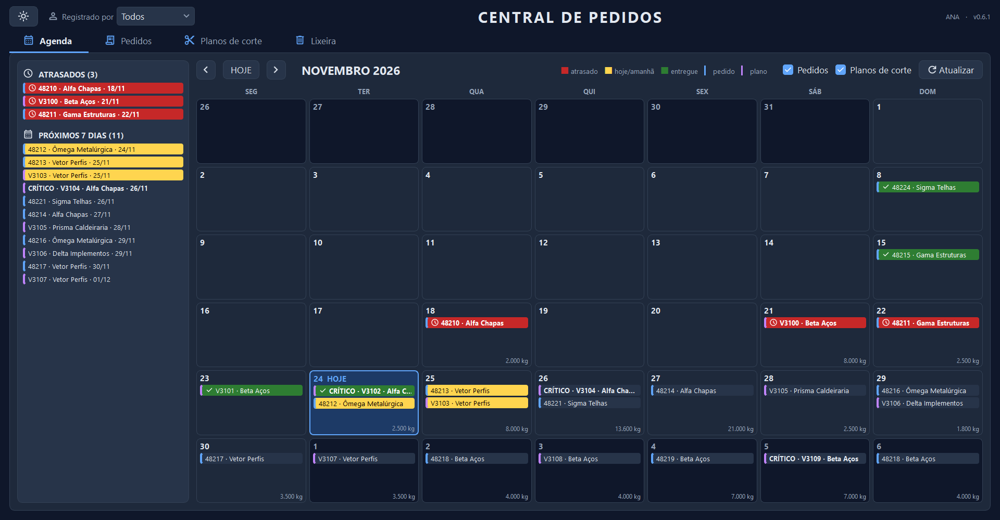<br/>
  <i>Agenda: o mês inteiro com cores por prazo, atrasados e próximos 7 dias ao lado</i>
</p>

| | |
|---|---|
| 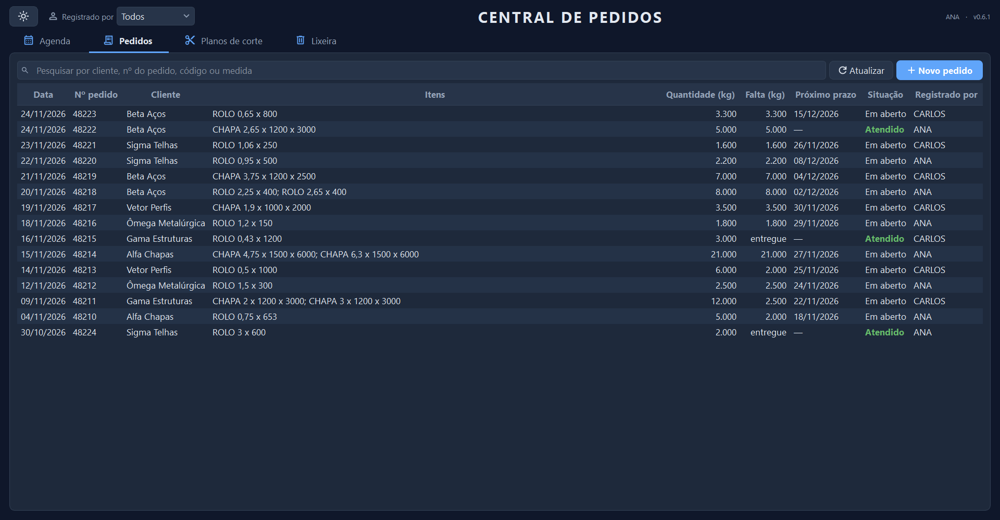<br/><i>Pedidos: falta, próximo prazo e situação de cada um</i> | 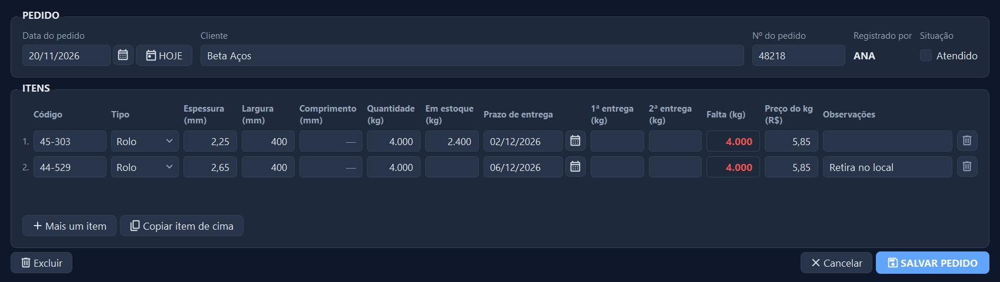<br/><i>Pedido com vários itens e saldo calculado sozinho</i> |
| 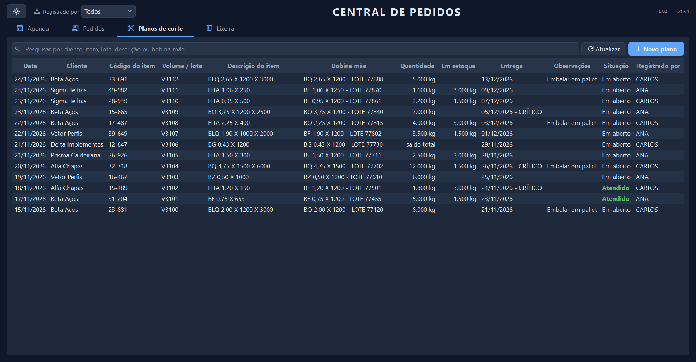<br/><i>Planos de corte com bobina mãe, lote e críticos</i> | 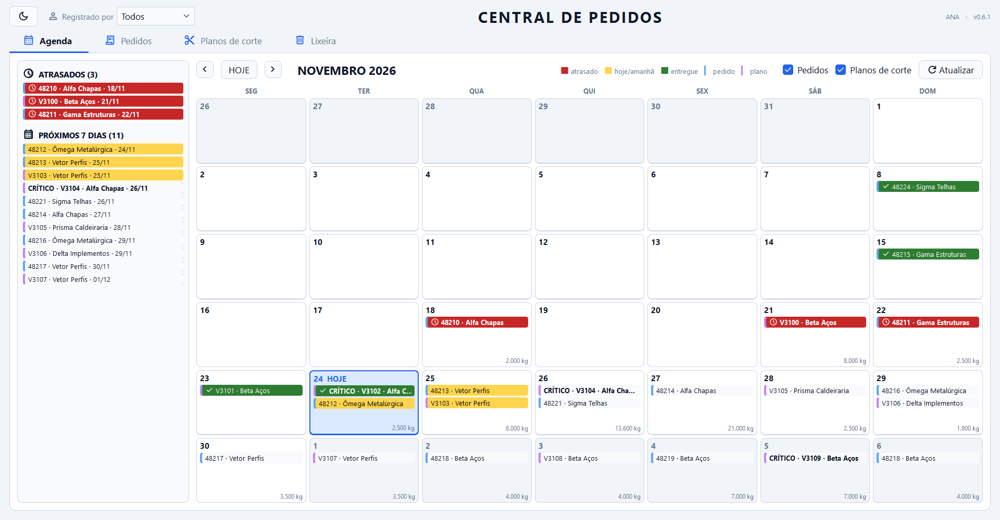<br/><i>Modo claro, escolhido por cada pessoa</i> |

<p align="center">
  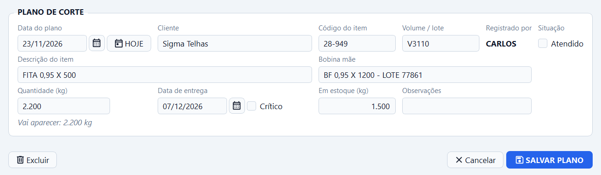<br/>
  <i>Cadastro do plano de corte</i>
</p>

## ✨ Funcionalidades

- [x] **Agenda** do mês com etiquetas por dia (pedido e plano), total de kg do dia e coluna de
      **atrasados** e **próximos 7 dias**; clicar abre o registro
- [x] Cores pelo prazo: 🔴 atrasado · 🟡 hoje/amanhã · neutro no prazo · 🟢 entregue
- [x] **Pedidos com vários itens**: código, rolo ou chapa, espessura, largura, comprimento (some no
      rolo), quantidade, em estoque, prazo, 1ª e 2ª entrega, **falta automática** e preço do kg por item
- [x] **Planos de corte**: cliente, item, lote, descrição, bobina mãe, quantidade, entrega, crítico e em estoque
- [x] Situação **Atendido / Em aberto** (o pedido com tudo entregue fica atendido sozinho)
- [x] **Cliente com sugestões** enquanto digita e confirmação antes de criar um cliente novo
- [x] Botão **HOJE**, calendário em todo campo de data e "copiar item de cima"
- [x] **Nome do vendedor automático** a partir do usuário do Windows (`joao.silva` → **JOAO**)
- [x] **Filtro "Registrado por"** valendo para todas as abas
- [x] **Trava por pedido/plano**: quem tenta abrir o que outro edita vê um aviso com o nome
- [x] **Lixeira** com restaurar e excluir de vez
- [x] Tema **azul-marinho** em modo **claro e escuro**, escolhido e lembrado por pessoa
- [x] Pesquisa por cliente, número, código, medida, lote ou bobina

## 🧭 UX: o programa é para outras pessoas

Diferente dos meus outros programas, que eu mesmo uso, este foi **pedido pelos vendedores** e é
usado **100% por eles**. Por isso o desenvolvimento seguiu práticas de UX:

- **Entrevista com quem usa** antes de desenhar qualquer tela (o que fazem, o que irrita, o que falta).
- **Protótipo rápido**: começar com a primeira entrevista e melhorar com a opinião dos demais.
- **Escolha visual por foto**: três propostas de tema, cada uma em modo claro e escuro, comparadas
  lado a lado antes de virar código.
- **Nunca passar informação só pela cor** e ícones apenas onde explicam algo.

### Como a agenda decide a cor

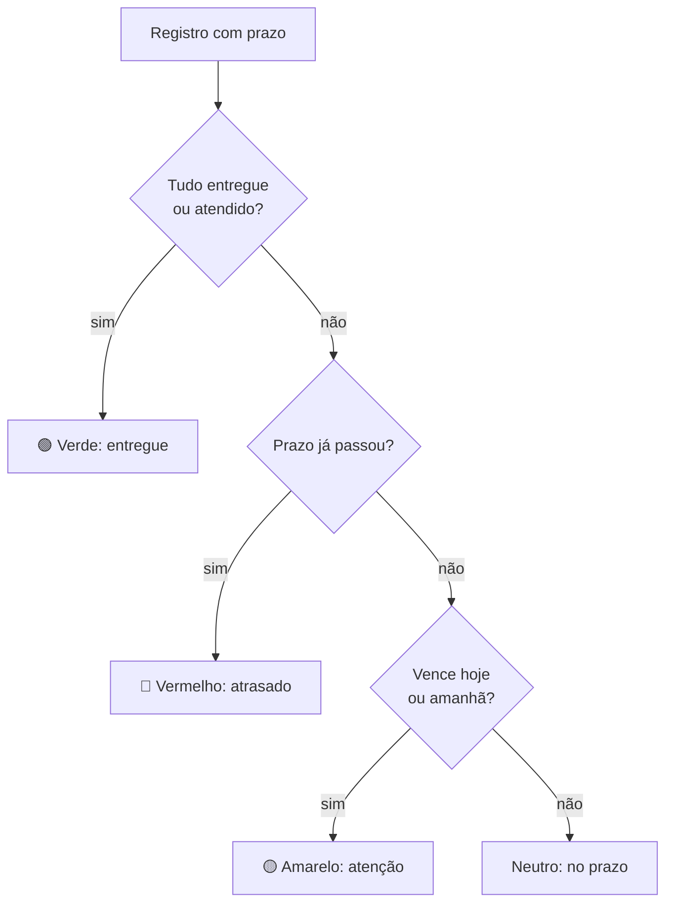

## 🏗️ Arquitetura

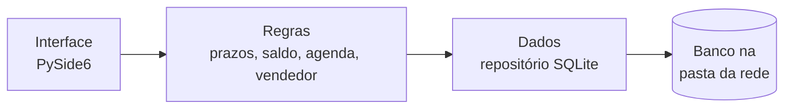

Camadas independentes: a regra de negócio não conhece a tela. O programa fica numa **pasta comum
da rede**, sem servidor, e os vendedores gravam ao mesmo tempo — com uma trava **por pedido**:
se alguém está editando um pedido, o colega vê quem é e espera. A trava solta sozinha se o
programa de quem editava fechar ou parar de responder.

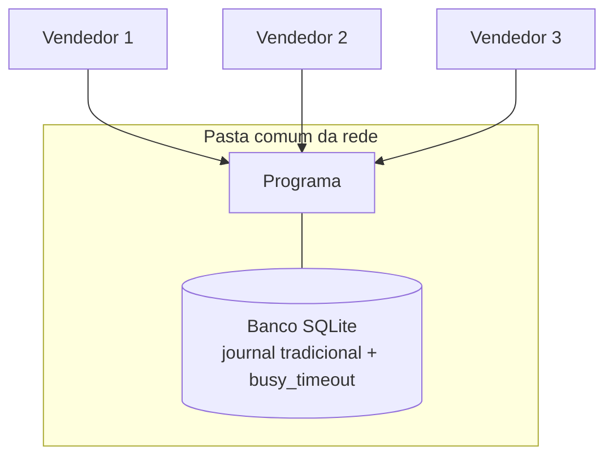

| Tecnologia | Aplicação no projeto |
|---|---|
| **Python 3.12+** | Linguagem de todo o programa |
| **PySide6 (Qt)** | Janelas, abas, agenda, calendário e tema claro/escuro |
| **SQLite** | Banco de dados num arquivo, na pasta da rede, com transações curtas |
| **Material Symbols** | Ícones (licença Apache 2.0, arquivo `LICENSE` junto) |
| **pytest** | Testes automáticos, inclusive da janela sem abrir na tela |
| **Ruff** | Padronização do código |
| **Claude Code** | Desenvolvimento assistido por IA, passo a passo |

## 🗃️ Modelo de dados

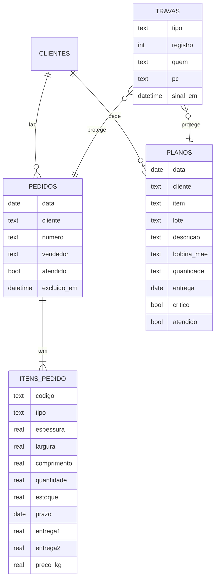

Exclusão é **lógica**: o registro ganha a data de exclusão e vai para a Lixeira.

## 🛠️ Como foi desenvolvido

- Desenvolvimento **assistido por IA (Claude Code)**, uma etapa por vez, com branch e pull request.
- **Testes automáticos** desde o primeiro dia; os testes nunca mexem nas preferências reais de quem roda.
- **Versionamento semântico**: `0.x` a cada fase, tag Git por versão.
- **Cada ícone e cada tela aprovados por foto** antes de entrar.
- Dados reais da empresa ficam **fora do repositório**; exemplos e fotos usam nomes fictícios.

<details>
<summary><b>🗺️ Roteiro</b></summary>

- [x] **0.1** — Base: janela, abas, tema claro/escuro, nome do vendedor
- [x] **0.2** — Pedidos com itens, entregas e saldo
- [x] **0.3** — Planos de corte
- [x] **0.4** — Agenda visual dos prazos
- [x] **0.5** — Filtro por vendedor, Lixeira e trava por pedido
- [x] **0.6** — Situação Atendido / Em aberto e campo Em estoque

</details>

<details>
<summary><b>📜 História das fases</b></summary>

| Fase | O que entrou |
|---|---|
| 0.1 | Janela com abas, tema azul-marinho claro/escuro, nome automático do vendedor |
| 0.2 | Pedido com vários itens, rolo/chapa, entregas, falta automática, cliente com sugestões |
| 0.3 | Plano de corte com bobina mãe, lote, crítico |
| 0.4 | Agenda do mês, cores pelo prazo, atrasados e próximos 7 dias |
| 0.5 | Lixeira, trava por pedido/plano, filtro "Registrado por" |
| 0.6 | Atendido / Em aberto (automático quando tudo é entregue), Em estoque (kg) |

</details>

## 📁 Estrutura do repositório

```
src/planos_pedidos/
├── interface/   telas (agenda, pedidos, planos, lixeira), tema e ícones
├── regras/      regras de negócio (prazos, saldo, agenda, nome do vendedor)
└── dados/       repositório do banco SQLite
tests/           testes automáticos (regras, banco e janela)
docs/telas/      fotos com dados fictícios
```

## 💼 Competências

UX com usuários reais · Python · Interfaces desktop com Qt · SQLite em rede · Testes automáticos ·
Git e GitHub · Desenvolvimento com IA

---

<p align="center"><b>Um programa feito a partir de quem vai usar: menos planilhas espalhadas, mais prazos cumpridos.</b></p>
