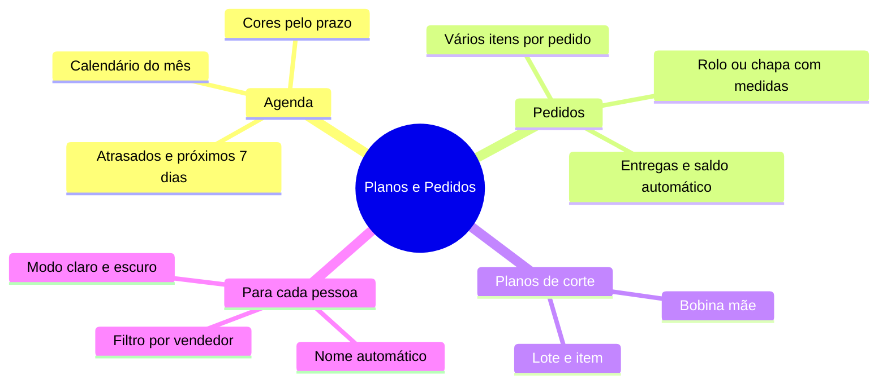
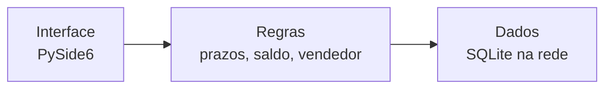

# Planos e Pedidos

<p align="center">
  
  
  
  
</p>
<p align="center">
  
  
  
  
</p>
<p align="center">
  
  
  
  
  
  
</p>

<p align="center">
  Aplicativo desktop que junta, num lugar só, os <b>pedidos de clientes</b> e os <b>planos de corte</b>
  que cada vendedor anotava na própria planilha — com uma agenda visual dos prazos de entrega, para
  que todos saibam o que os colegas estão fazendo e o que vence em cada dia.
</p>

<p align="center">
  <a href="#-visão-geral">Visão Geral</a> •
  <a href="#-ux-o-programa-é-para-outras-pessoas">UX</a> •
  <a href="#-funcionalidades">Funcionalidades</a> •
  <a href="#️-arquitetura">Arquitetura</a> •
  <a href="#️-como-foi-desenvolvido">Desenvolvimento</a> •
  <a href="#-estrutura-do-repositório">Estrutura</a>
</p>

---

## 📌 Visão Geral

Numa empresa de corte e venda de aço (bobinas, rolos e chapas), cada vendedor registrava os
**pedidos** (material já cortado, em estoque) e os **planos de corte** (serviço de cortar uma
bobina para o cliente) em **planilhas separadas**. Ninguém via o que o outro estava fazendo, e o
acompanhamento dos prazos dependia de cada um lembrar de olhar a sua.

| ❌ Problema | 💡 Solução | ✅ Resultado esperado |
|---|---|---|
| Uma planilha por vendedor, sem ligação entre elas | Um programa único numa pasta da rede, usado por todos ao mesmo tempo | Todos veem tudo, com filtro por vendedor |
| Prazos espalhados em linhas de tabela | **Agenda** em forma de calendário, com cores por situação do prazo | Atrasados e entregas do dia saltam aos olhos |
| "Falta entregar" calculado à mão | Entregas lançadas em kg; o saldo é calculado sozinho | Item entregue ganha um ✔ verde |
| Digitação repetida e nomes escritos de jeitos diferentes | Botão HOJE, cliente com sugestões, pedido com vários itens | Menos digitação e dados padronizados |
| Não se sabia quem registrou cada linha | Nome tirado do usuário do Windows, sem digitar | Cada registro mostra o vendedor |



## 🧭 UX: o programa é para os vendedores

O programa atende uma necessidade da **equipe de vendas** e é
usado **100% pelos vendedores**. Por isso o desenvolvimento segue práticas de UX:

- **Entrevista com quem usa** antes de desenhar qualquer tela (o que fazem, o que incomoda, o que falta).
- **Protótipo rápido**: começar com a primeira entrevista e melhorar com a opinião dos demais.
- **Escolha visual por foto**: três propostas de tema, cada uma em modo claro e escuro, comparadas
  lado a lado antes de virar código.
- **Nunca passar informação só pela cor** e ícones apenas onde explicam algo.

## ✨ Funcionalidades

- [x] Janela com as abas **Agenda**, **Pedidos** e **Planos de corte**
- [x] Tema **azul-marinho** em modo **claro e escuro**, escolhido e lembrado por pessoa
- [x] **Nome do vendedor automático** a partir do usuário do Windows (`joao.silva` → **JOAO**)
- [ ] Cadastro de pedidos com vários itens, entregas e saldo automático
- [ ] Cadastro de planos de corte
- [ ] Agenda visual dos prazos
- [ ] Filtro por vendedor, Lixeira e trava por pedido em edição

## 🏗️ Arquitetura



Camadas independentes: a regra de negócio não conhece a tela. O programa fica numa **pasta comum
da rede**, sem servidor, e os vendedores gravam ao mesmo tempo — com uma trava **por pedido**:
se alguém está editando um pedido, o colega vê quem é e espera.

| Tecnologia | Aplicação no projeto |
|---|---|
| **Python 3.12+** | Linguagem de todo o programa |
| **PySide6 (Qt)** | Janelas, abas, calendário e tema claro/escuro |
| **SQLite** | Banco de dados num arquivo, na pasta da rede |
| **Material Symbols** | Ícones (licença Apache 2.0, arquivo `LICENSE` junto) |
| **pytest** | Testes automáticos, inclusive da janela sem abrir na tela |
| **Ruff** | Padronização do código |
| **Claude Code** | Desenvolvimento assistido por IA, passo a passo |

## 🛠️ Como foi desenvolvido

- Desenvolvimento **assistido por IA (Claude Code)**, uma etapa por vez, com branch e pull request.
- **Testes automáticos** desde o primeiro dia; os testes nunca alteram as preferências reais de quem roda.
- **Versionamento semântico**: `0.x` em desenvolvimento, `1.0.0` quando entrar em uso.
- Dados reais da empresa ficam **fora do repositório**; exemplos usam nomes fictícios.

<details>
<summary><b>🗺️ Roteiro</b></summary>

- [x] **0.1** — Base: janela, abas, tema claro/escuro, nome do vendedor
- [ ] **0.2** — Pedidos com itens, entregas e saldo
- [ ] **0.3** — Planos de corte
- [ ] **0.4** — Agenda visual dos prazos
- [ ] **0.5** — Filtro por vendedor, Lixeira e trava por pedido
- [ ] **1.0** — Primeira versão em uso pelos vendedores

</details>

## 📁 Estrutura do repositório

```
src/planos_pedidos/
├── interface/   telas, tema e ícones
├── regras/      regras de negócio (ex.: nome do vendedor)
└── dados/       acesso ao banco
tests/           testes automáticos
```

## 💼 Competências

UX com usuários reais · Python · Interfaces desktop com Qt · Testes automáticos · Git e GitHub ·
Desenvolvimento com IA

---

<p align="center"><b>Um programa feito a partir de quem vai usar: menos planilhas espalhadas, mais prazos cumpridos.</b></p>
